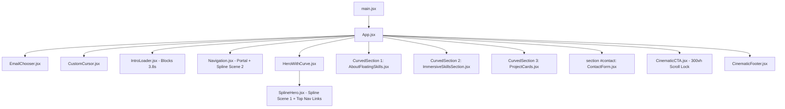
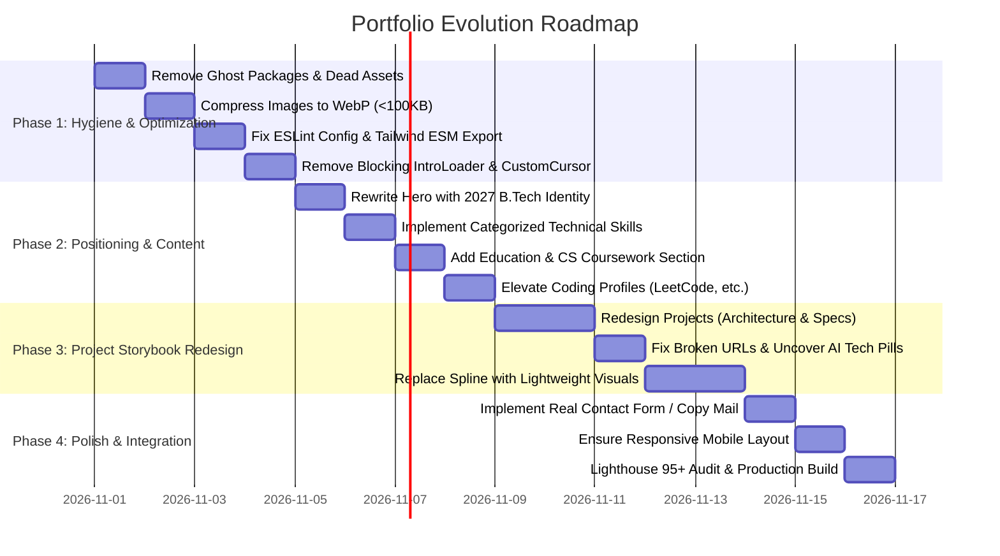

# Technical Portfolio Audit Report

**Audited Target:** Personal Portfolio (`my-portfolio`)  
**Auditor:** Senior Full-Stack Engineer & UI/UX Technical Reviewer  
**Date of Audit:** October 28, 2026  
**Audited Codebase Root:** `d:/My portfolio/my-portfolio`  
**Candidate Profile:** 2027 B.Tech Computer Science & Engineering Graduate  
**Target Roles:** Software Development Engineer (SDE), Backend Engineer, AI Engineer, Generative AI Engineer, Full-Stack Engineer  

---

## 1. Executive Summary

A comprehensive, read-only technical audit was conducted on the existing portfolio repository. The portfolio is currently implemented as a single-page React application powered by Vite, Tailwind CSS, Framer Motion, and Spline 3D.

### Core Verdict
While the current site demonstrates an ambitious desire for cinematic visual presentation (3D Spline scenes, liquid text reveals, stacked sticky cards, and custom cursor animations), **the technical implementation and content positioning currently undermine the candidate's core professional goals**:

1. **Severe Performance & Asset Bloat:** The production build generates **4.88 MB of uncompressed client JavaScript** (vendor chunk: 2.41 MB; physics engine chunk: 1.99 MB) driven primarily by `@splinetool/react-spline`. Combined with **13.8 MB of uncompressed project PNGs** and an **8.42 MB profile image** in [`public/profile-photo.jpg`](file:///d:/My%20portfolio/my-portfolio/public/profile-photo.jpg), the first-load payload exceeds **27 MB**—before fetching two remote Spline 3D scenes over the network.
2. **Artificial Friction & Disorienting UX:** An artificial loading screen ([`IntroLoader.jsx`](file:///d:/My%20portfolio/my-portfolio/src/components/IntroLoader.jsx)) forces visitors to wait **3.8 seconds** watching a mock progress bar before any content renders. Furthermore, pinned scroll hijacking (300vh scroll lock in [`CinematicCTA.jsx`](file:///d:/My%20portfolio/my-portfolio/src/components/CinematicCTA.jsx#L44)) and a custom desktop cursor ([`CustomCursor.jsx`](file:///d:/My%20portfolio/my-portfolio/src/components/CustomCursor.jsx#L119)) create high input latency and accessibility barriers.
3. **Severe Positioning Mismatch for SDE / Backend / AI Roles:** The candidate is a 2027 B.Tech CSE student targeting SDE, Backend, and Applied AI roles. However:
   - Education, university, graduation year (2027), and CS fundamentals are **100% absent**.
   - The skills section ([`skills.js`](file:///d:/My%20portfolio/my-portfolio/src/data/skills.js)) lists only 8 frontend/MERN items. Python, Flask, FastAPI, C++, Java, SQL, PostgreSQL, Docker, Redis, LangChain, RAG, and LLM APIs are completely omitted from the skills data.
   - Project cards truncate technologies to only 5 items ([`ProjectCards.jsx:165`](file:///d:/My%20portfolio/my-portfolio/src/components/ProjectCards.jsx#L165)), hiding all AI and backend frameworks (Whisper, Gemini AI, OpenCV, MediaPipe) on the candidate's flagship project, *ProedXAI*.
   - Competitive programming handles (LeetCode, CodeChef, Codeforces)—critical signals for campus SDE hiring—are hidden in tiny footer icons ([`CinematicFooter.jsx:43-59`](file:///d:/My%20portfolio/my-portfolio/src/components/CinematicFooter.jsx#L43-L59)).
4. **Broken Links & Deceptive Form Behavior:** Two projects contain placeholder links (`example.com/chat`, `example.com/tasks`), which also leak into the GitHub button links ([`ProjectCards.jsx:198`](file:///d:/My%20portfolio/my-portfolio/src/components/ProjectCards.jsx#L198)). The contact form ([`ContactForm.jsx`](file:///d:/My%20portfolio/my-portfolio/src/components/ContactForm.jsx)) does not dispatch messages to an API; it forces desktop users into a `window.open` Gmail web URL and displays "Message Sent!" regardless of whether an email was ever sent.
5. **Code Hygiene & Build Issues:** Running `npm run lint` yields **21 problems (20 errors, 1 warning)**. Six npm dependencies in [`package.json`](file:///d:/My%20portfolio/my-portfolio/package.json) are completely unused ghost packages.

---

## 2. Important File Map & Architecture

### 2.1 File Map
```text
my-portfolio/
├── index.html                   # HTML entry point (contains duplicate meta tags & title)
├── package.json                 # Dependencies (contains 6 ghost packages)
├── vite.config.js               # Standard Vite configuration with @vitejs/plugin-react
├── tailwind.config.js           # Tailwind configuration (uses CommonJS module.exports in ESM project)
├── postcss.config.js            # PostCSS configuration with Tailwind and Autoprefixer
├── eslint.config.js             # Flat ESLint configuration (fails on JSX motion components)
├── public/
│   ├── Resume.pdf               # 100 KB candidate resume
│   ├── profile-photo.jpg        # 8.42 MB uncompressed photo (critical performance hazard)
│   ├── logos/                   # Empty directory
│   └── projects/                # Empty directory
└── src/
    ├── main.jsx                 # React 19 root mount
    ├── App.jsx                  # Main single-page layout & component orchestrator
    ├── index.css                # Global CSS, Urbanist font import, marquee utilities
    ├── assets/
    │   ├── College-dash.png     # 1.21 MB project screenshot
    │   ├── Goal-tracker.png     # 3.63 MB project screenshot
    │   ├── Hospital-dashboard.png # 4.56 MB project screenshot
    │   ├── collabTool.png       # 1.45 MB project screenshot
    │   ├── live-interview.png   # 0.95 MB project screenshot
    │   ├── Velocitix-1..4.jpg   # 724 KB unused dead assets
    │   └── skills/              # 6 unused PNG icons (remote jsdelivr used instead)
    ├── components/
    │   ├── IntroLoader.jsx      # Artificial 3.8s blocking welcome screen
    │   ├── Navigation.jsx       # Floating hamburger + full-screen portal + second Spline scene
    │   ├── HeroWithCurve.jsx    # Hero wrapper with scroll-animated SVG curve
    │   ├── SplineHero.jsx       # 3D Spline scene 1 + top navigation links + typewriter hero
    │   ├── AboutFloatingSkills.jsx # About text + 8.4MB circular photo (no floating skills)
    │   ├── ImmersiveSkillsSection.jsx # Horizontal marquee of 8 CDN skill icons
    │   ├── ProjectCards.jsx     # Sticky stacked cards with image carousel & links
    │   ├── ContactForm.jsx      # Client-side form triggering mailto/Gmail popup
    │   ├── CinematicCTA.jsx     # 300vh scroll-pinned liquid text reveal
    │   ├── CinematicFooter.jsx  # 4-column footer with social & competitive programming links
    │   ├── CurvedSection.jsx    # Reusable section wrapper with animated SVG wave
    │   ├── CustomCursor.jsx     # Viewport-fixed custom ring cursor (disables native cursor)
    │   ├── EmailChooser.jsx     # Mobile modal for choosing Gmail App vs Gmail Web
    │   ├── TypewriterText.jsx   # 16ms interval ticker for typed hero text
    │   ├── Logo.jsx             # Stylized SVG 'B' logo
    │   ├── AnimatedNavLink.jsx  # Text link with underline hover transition
    │   └── FloatingSkillIcon.jsx # Unused dead component
    ├── data/
    │   ├── projects.js          # Array of 5 projects (contains placeholder URLs)
    │   └── skills.js            # Array of 8 frontend/MERN skills
    ├── hooks/
    │   └── usePerformanceMode.js # Feature detection for reduced motion & hardware limits
    └── utils/
        └── emailHelper.js       # Desktop window.open(Gmail) & mobile custom event dispatcher
```

### 2.2 Architectural Flow


---

## 3. Main Page & Component Implementation Summary

| Component | Verified Role & Implementation | State & Data Flow | Technical Issues / Deficiencies |
| :--- | :--- | :--- | :--- |
| **`App.jsx`** ([L1-73](file:///d:/My%20portfolio/my-portfolio/src/App.jsx#L1-L73)) | Orchestrates layout and mounts sections sequentially. No client routing (`react-router-dom`). | Manages `showLoader` state. Passes `onComplete` to `IntroLoader`. | Unused import `useEffect` ([L1](file:///d:/My%20portfolio/my-portfolio/src/App.jsx#L1)). Section ordering places `#contact` *above* `CinematicCTA`, causing inverted navigation. |
| **`IntroLoader.jsx`** ([L1-91](file:///d:/My%20portfolio/my-portfolio/src/components/IntroLoader.jsx#L1-L91)) | Fullscreen overlay displaying "Initializing System" with a fake 0–100% counter. | Uses `setInterval` every 15ms and a 2.8s `setTimeout` + 1.0s Framer Motion fade-out. | **Blocks portfolio access for 3.8 seconds**. Recruiters on average spend 10–15 seconds total; this is a severe UX bottleneck. |
| **`SplineHero.jsx`** ([L1-150](file:///d:/My%20portfolio/my-portfolio/src/components/SplineHero.jsx#L1-L150)) | Hero banner embedding remote Spline 3D scene (`uIR4KYYy0DxHXp0P`), Typewriter title, and top navbar. | Detects desktop width (`>= 768px`) and listens for `useInView` & `shouldReduceMotion`. | Duplicates navigation bar with `Navigation.jsx`. Loads remote heavy 3D asset. Typewriter delay totals 4.5+ seconds. |
| **`Navigation.jsx`** ([L1-157](file:///d:/My%20portfolio/my-portfolio/src/components/Navigation.jsx#L1-L157)) | Floating hamburger button appearing after scrolling 70% viewport; opens full-screen menu via `ReactDOM.createPortal`. | `isOpen`, `showButton`, `isDesktop` local state. Listens to scroll and resize events. | **Loads a SECOND remote Spline scene** (`PIA7BlRgB6HhBz0f`) inside the menu modal. Covers Spline watermark with hardcoded badge ([L140-145](file:///d:/My%20portfolio/my-portfolio/src/components/Navigation.jsx#L140-L145)). |
| **`AboutFloatingSkills.jsx`** ([L1-76](file:///d:/My%20portfolio/my-portfolio/src/components/AboutFloatingSkills.jsx#L1-L76)) | Introduces candidate ("Bharadwaj Donthikurthi") and displays animated circular photo frame. | `paused` and `imageLoaded` toggle state. | Component name is a misnomer (contains zero floating skills). Loads **8.42 MB uncompressed photo** (`/profile-photo.jpg`). Missing education, university, grad year, and target roles. |
| **`ImmersiveSkillsSection.jsx`** ([L1-156](file:///d:/My%20portfolio/my-portfolio/src/components/ImmersiveSkillsSection.jsx#L1-L156)) | Infinite horizontal marquee of 8 skill cards with radial brand glows. | Uses `skillsRaw` from `skills.js`. Dynamically computes marquee animation duration. | Injects inline `<style>` tag into DOM ([L76-88](file:///d:/My%20portfolio/my-portfolio/src/components/ImmersiveSkillsSection.jsx#L76-L88)). Unused state variables `hovered`, `setHovered`. Relies on remote `cdn.jsdelivr.net` SVGs with brittle CSS `invert(1)` filters. Missing backend/AI skills. |
| **`ProjectCards.jsx`** ([L1-261](file:///d:/My%20portfolio/my-portfolio/src/components/ProjectCards.jsx#L1-L261)) | Sticky stacked project cards with automatic carousel, description, tags, and external links. | Tracks scroll progress via `useScroll`. Individual card tracks active image index and hover. | Non-existent Tailwind class `max-w-9xl` ([L75](file:///d:/My%20portfolio/my-portfolio/src/components/ProjectCards.jsx#L75)). Truncates tech stack to 5 items (`tech.slice(0, 5)` at [L165](file:///d:/My%20portfolio/my-portfolio/src/components/ProjectCards.jsx#L165)), hiding AI tech. Fallback bug at [L198](file:///d:/My%20portfolio/my-portfolio/src/components/ProjectCards.jsx#L198) links GitHub to dummy URLs. Card height `h-[65vh]` overflows on mobile. |
| **`ContactForm.jsx`** ([L1-143](file:///d:/My%20portfolio/my-portfolio/src/components/ContactForm.jsx#L1-L143)) | 2-column contact section with direct email link and name/email/message form. | Local state for `name`, `email`, `message`, `status`. | **Simulates submission without sending**: calls `handleEmail` (opening Gmail) and blindly sets status to "Message Sent!" after 500ms ([L27](file:///d:/My%20portfolio/my-portfolio/src/components/ContactForm.jsx#L27)). |
| **`CinematicCTA.jsx`** ([L1-162](file:///d:/My%20portfolio/my-portfolio/src/components/CinematicCTA.jsx#L1-L162)) | Sticky 300vh scroll section with liquid text fill effect ("Ready to turn Your ideas into reality?"). | Tracks scroll progress across 300vh via `useScroll` + `useSpring`. | **Severe scroll hijacking**: forces user through 300vh of blank scrolling. "Contact Now" button links to `#contact` which sits *above* this section, forcing an awkward reverse scroll jump. |
| **`CinematicFooter.jsx`** ([L1-205](file:///d:/My%20portfolio/my-portfolio/src/components/CinematicFooter.jsx#L1-L205)) | 4-column footer with bio, nav links, social links, and competitive programming profiles. | Static display with Framer Motion entry fades. | Outdated color tokens (`hover:text-indigo-400`, `bg-indigo-600`) clash with monochrome theme. Competitive coding profiles (LeetCode, CodeChef, Codeforces) are buried. |
| **`CustomCursor.jsx`** ([L1-169](file:///d:/My%20portfolio/my-portfolio/src/components/CustomCursor.jsx#L1-L169)) | Viewport-fixed custom hollow circle cursor following mouse coordinates. | Uses `requestAnimationFrame` lerp loop with mouse coordinate refs. | Injects global style rule `html, body { cursor: none !important; }` ([L119](file:///d:/My%20portfolio/my-portfolio/src/components/CustomCursor.jsx#L119)). Flickers between custom cursor and native cursor on interactive elements. |
| **`usePerformanceMode.js`** ([L1-28](file:///d:/My%20portfolio/my-portfolio/src/hooks/usePerformanceMode.js#L1-L28)) | Custom hook evaluating `hardwareConcurrency <= 4`, `deviceMemory <= 4`, `saveData`, and reduced motion. | Evaluates navigator properties on mount; attaches media query listener. | Overly aggressive: any standard laptop or privacy browser reporting `hardwareConcurrency = 4` triggers `shouldReduceMotion = true`, stripping all 3D and animations without user choice. |

---

## 4. Current Design & Content Assessment

### 4.1 UI/UX & Visual Design
- **Theme Inconsistency:** The application markets itself as "Cinematic Monochrome" (black background `#000000`, white cards `#ffffff`, zinc accents `#18181b`). However, multiple legacy color artifacts persist:
  - Indigo ambient blur in `CinematicFooter.jsx` ([L66](file:///d:/My%20portfolio/my-portfolio/src/components/CinematicFooter.jsx#L66)) and hover links (`text-indigo-400` at [L111](file:///d:/My%20portfolio/my-portfolio/src/components/CinematicFooter.jsx#L111)).
  - Indigo accent blur in `EmailChooser.jsx` ([L129-130](file:///d:/My%20portfolio/my-portfolio/src/components/EmailChooser.jsx#L129-L130)).
  - Rainbow brand drop-shadows on skill cards in `ImmersiveSkillsSection.jsx` ([L136](file:///d:/My%20portfolio/my-portfolio/src/components/ImmersiveSkillsSection.jsx#L136)).
- **Scroll Hijacking & Motion Fatigue:**
  - `HeroWithCurve.jsx` and `CurvedSection.jsx` recalculate SVG quadratic bezier curve paths on every scroll tick using `useTransform`.
  - `ProjectCards.jsx` stacks cards with sticky positioning (`top: topOffset`), which creates jarring scroll deceleration on touchscreens and trackpads.
  - `CinematicCTA.jsx` occupies `300vh` purely to animate text stroke clip paths.
- **Accessibility & Contrast:**
  - Overriding the OS cursor (`cursor: none !important`) impairs navigation for users with low vision or motor impairments.
  - Subtitle copy in multiple sections uses `text-gray-500` or `text-zinc-700` over pure `#000000` backgrounds, failing WCAG 2.1 AA contrast requirements (< 3:1 contrast ratio).
  - The hamburger button has no `aria-label`, and interactive image navigation buttons in `ProjectCards` lack accessible screen reader labels.

### 4.2 Content & Career Alignment Assessment

| Evaluation Dimension | Current State | Required State for SDE / Backend / AI Target |
| :--- | :--- | :--- |
| **Hero Identity** | "Hi! I am Bharadwaj / I create digital experiences. By building scalable web experiences that feel fast, fluid, and human." | "Bharadwaj Donthikurthi — Software Engineer (Backend, Applied AI & Full-Stack). 2027 B.Tech CSE Graduate building high-concurrency systems and generative AI tools." |
| **Education & Credentials** | **Completely absent.** No degree, college name, GPA/grades, or 2027 graduation year. | Clear Education section highlighting B.Tech in Computer Science & Engineering (Class of 2027), relevant coursework (OS, DBMS, Networks, DSA, AI/ML). |
| **Technical Skills** | 8 skills in a single unorganized marquee: React, JS, Node, Mongo, Express, Tailwind, Framer Motion, Git. | Categorized skill matrix: <br>1. **Backend & Systems:** Node.js, Express, Python, Flask, REST APIs, Microservices, Socket.IO. <br>2. **Applied AI & ML:** Google Gemini API, OpenAI / Whisper, OpenCV, MediaPipe, RAG, Embeddings. <br>3. **Databases & Cloud:** MongoDB, PostgreSQL / SQL, Redis, Cloudinary. <br>4. **Frontend & Full-Stack:** React, JavaScript (ES6+), Tailwind CSS, Vite. <br>5. **Languages & Core:** Python, JavaScript, C/C++, Data Structures & Algorithms, Git. |
| **Project Presentation** | 5 projects displayed as visual screenshot sliders with brief descriptions. Feature lists in `projects.js` are never rendered. | Deep-dive storybook cards with problem statement, system architecture, engineering challenges (e.g. dual-engine Flask+Node latency, audio transcription pipelines), performance metrics, and verified links. |
| **Coding Profiles** | Hidden in the footer (LeetCode, CodeChef, Codeforces under username `messironaldo27` / `messironaldo10`). | Elevated to prominent view with verified stats (problems solved, contest ratings, core algorithms mastered) as proof of problem-solving ability for SDE roles. |

---

## 5. Technical Quality & Code Integrity

### 5.1 Build & Lint Verification (Executed Commands)

#### 1. ESLint (`npm run lint`) — Status: FAILED (Exit code: 1)
ESLint reported **21 problems (20 errors, 1 warning)**:
- **Rule `no-unused-vars` failure across 14 components:** `eslint.config.js` sets `'no-unused-vars': ['error', { varsIgnorePattern: '^[A-Z_]' }]`. Because ESLint's default rules do not recognize `<motion.div>` as a variable usage, every `import { motion } from 'framer-motion'` is flagged as an error.
- **Real unused variables:**
  - [`src/App.jsx:1:27`](file:///d:/My%20portfolio/my-portfolio/src/App.jsx#L1): `'useEffect' is defined but never used.`
  - [`src/components/ImmersiveSkillsSection.jsx:8:10,19`](file:///d:/My%20portfolio/my-portfolio/src/components/ImmersiveSkillsSection.jsx#L8): `'hovered'` and `'setHovered'` defined but unused.
  - [`src/components/ProjectCards.jsx:7:68`](file:///d:/My%20portfolio/my-portfolio/src/components/ProjectCards.jsx#L7): `'color'` defined but unused.
  - [`src/components/TypewriterText.jsx:33:6`](file:///d:/My%20portfolio/my-portfolio/src/components/TypewriterText.jsx#L33): Missing hook dependencies (`lineDelay`, `lines`, `restartDelay`, `typingDelay`).
- **Module format collision:**
  - [`tailwind.config.js:2:1`](file:///d:/My%20portfolio/my-portfolio/tailwind.config.js#L2): `module.exports = { ... }` throws `'module' is not defined` because the project is ESM (`"type": "module"` in `package.json`).

#### 2. Vite Production Build (`npm run build`) — Status: PASSED WITH CRITICAL WARNINGS
The build completed in 18.82s but generated oversized assets:
```text
dist/assets/physics-ChHD2_fM.js                     1,987.56 kB │ gzip: 722.72 kB
dist/assets/index-CfIiDTNk.js                       2,408.48 kB │ gzip: 698.96 kB
dist/assets/opentype-U-0Y99ve.js                      173.53 kB │ gzip:  50.26 kB
dist/assets/Hospital-dashboard-Bt0dSVpd.png         4,557.93 kB
dist/assets/Goal-tracker-0FJ_spN0.png               3,632.78 kB
dist/assets/collabTool-CBYcRU5Q.png                 1,452.15 kB
dist/assets/College-dash-BdCd4RN2.png               1,214.48 kB
dist/assets/live-interview-BoZy69RN.png               948.85 kB
```
- **Total JS Payload:** 4.88 MB uncompressed (Spline physics engine alone is ~2 MB).
- **Total Image Assets:** 13.8 MB bundled in `dist/assets/` + 8.42 MB in `public/profile-photo.jpg`.

### 5.2 Dead Code & Ghost Dependencies

#### Ghost Dependencies in `package.json` (Installed but never imported)
1. `@react-three/drei` (`^10.7.6`) — 0 imports across entire codebase.
2. `@react-three/fiber` (`^9.3.0`) — 0 imports across entire codebase.
3. `three` (`^0.160.0`) — 0 imports across entire codebase.
4. `@splinetool/r3f-spline` (`^1.0.0`) — 0 imports across entire codebase.
5. `@studio-freight/lenis` (`^1.0.42`) — Removed from code; only mentioned in comment at [`App.jsx:21`](file:///d:/My%20portfolio/my-portfolio/src/App.jsx#L21).
6. `react-intersection-observer` (`^9.16.0`) — 0 imports; Framer Motion's `useInView` is used instead.

#### Dead Files & Orphaned Assets
- **`src/components/FloatingSkillIcon.jsx`**: Completely unreferenced anywhere.
- **`src/assets/Velocitix-1.jpg` through `Velocitix-4.jpg`**: 724 KB of unused graphics.
- **`src/assets/skills/`**: Contains 6 PNGs (`express.png`, `git.png`, `js.png`, `mongodb.png`, `node.png`, `react.png`) that are never imported.
- **`src/styles/`**: Empty directory.
- **`public/logos/` & `public/projects/`**: Empty directories.

### 5.3 Broken & Misleading Links in `src/data/projects.js`
- **Task Widget Application (`id: 4`)**:
  - `link`: `"https://example.com/chat"` ([L156](file:///d:/My%20portfolio/my-portfolio/src/data/projects.js#L156)) — Placeholder domain.
  - `github`: Missing property. In `ProjectCards.jsx:198`, the code evaluates `href={github || link}`, causing the "GitHub" button to open `https://example.com/chat`!
- **Goal Tracker (`id: 5`)**:
  - `link`: `"https://example.com/tasks"` ([L184](file:///d:/My%20portfolio/my-portfolio/src/data/projects.js#L184)) — Placeholder domain.
  - `github`: Missing property. The GitHub button opens `https://example.com/tasks`!
  - `tech`: Inconsistently claims `"Next.js"`, `"Vite"`, and `"Electron.js"` simultaneously ([L194-199](file:///d:/My%20portfolio/my-portfolio/src/data/projects.js#L194-L199)).
- **Hospital Management Web App (`id: 3`)**:
  - `github`: Points to `https://github.com/Bharadwaj710/PROJECTS` ([L125](file:///d:/My%20portfolio/my-portfolio/src/data/projects.js#L125)), a generic repository rather than a dedicated project repo.

---

## 6. Key Problems & Improvements in Priority Order

| Priority | Issue / Defect | Location | Technical Impact | Recommended Action |
| :---: | :--- | :--- | :--- | :--- |
| **P0** | **Artificial 3.8s Blocking Loader** | [`IntroLoader.jsx:26-35`](file:///d:/My%20portfolio/my-portfolio/src/components/IntroLoader.jsx#L26-L35) | Recruiter bounce rate is near 100% when forced to wait 4s for an artificial progress bar before seeing any content. | **Eliminate `IntroLoader` entirely.** Render hero content immediately on first paint with fast CSS entrance animations. |
| **P0** | **Extreme Asset & JS Bloat (27MB+ payload)** | `public/profile-photo.jpg`, `src/assets/*.png`, `SplineHero.jsx` | 4.88 MB client JS and 22+ MB uncompressed images cause 10s+ load times on standard mobile/4G connections. | 1. Compress `profile-photo.jpg` from 8.4 MB to < 100 KB WebP. <br>2. Compress project images to modern WebP/AVIF (< 150 KB each). <br>3. Remove heavy Spline 3D scenes; replace with clean, lightweight interactive canvas or SVG vector engineering graphics. |
| **P0** | **Missing Core Identity for SDE / AI Roles** | Entire site; [`skills.js`](file:///d:/My%20portfolio/my-portfolio/src/data/skills.js), [`AboutFloatingSkills.jsx`](file:///d:/My%20portfolio/my-portfolio/src/components/AboutFloatingSkills.jsx) | Zero mention of B.Tech CSE (2027), university, CS fundamentals, Python, AI/GenAI frameworks, backend systems, or databases. | Re-anchor hero and about copy around 2027 CSE graduate targeting Backend/AI/SDE roles. Introduce categorized technical skills and dedicated Education section. |
| **P1** | **Truncated AI Projects & Broken Links** | [`ProjectCards.jsx:165,198`](file:///d:/My%20portfolio/my-portfolio/src/components/ProjectCards.jsx#L165), [`projects.js:156,184`](file:///d:/My%20portfolio/my-portfolio/src/data/projects.js#L156) | Flagship AI tech (Gemini, Whisper, OpenCV) is hidden from recruiters; GitHub buttons on 2 projects open dummy `example.com` pages. | Remove `slice(0, 5)` restriction. Add verified repository links or "Local / Desktop Build" status. Display architecture highlights and metrics for ProedXAI and Converge. |
| **P1** | **Scroll Hijacking (300vh CTA Lock & Sticky Stacking)** | [`CinematicCTA.jsx:44`](file:///d:/My%20portfolio/my-portfolio/src/components/CinematicCTA.jsx#L44), [`ProjectCards.jsx:70`](file:///d:/My%20portfolio/my-portfolio/src/components/ProjectCards.jsx#L70) | Frustrates navigation; causes backward jumping ("Contact Now" scrolls backwards up to `#contact`). | Replace 300vh scroll lock with a clean, high-impact CTA banner. Ensure natural browser scrolling throughout the entire page. |
| **P1** | **Fake Form Submission Behavior** | [`ContactForm.jsx:13-28`](file:///d:/My%20portfolio/my-portfolio/src/components/ContactForm.jsx#L13-L28) | Form claims "Message Sent!" while merely opening Gmail web in a pop-up. Recruiter inquiries are lost if pop-up is blocked. | Implement genuine email dispatch via EmailJS, Formspree, Resend API, or provide a 1-click clipboard email copy button. |
| **P2** | **Competitive Coding Profiles Buried in Footer** | [`CinematicFooter.jsx:43-59`](file:///d:/My%20portfolio/my-portfolio/src/components/CinematicFooter.jsx#L43-L59) | LeetCode, CodeChef, and Codeforces profiles are high-value evidence for 2027 graduate SDE roles, but are practically invisible. | Create a dedicated "Problem Solving & Core CS" card or badge row showcasing DSA ratings, platforms, and contest accomplishments. |
| **P2** | **6 Ghost Dependencies & Dead Code** | [`package.json:13-22`](file:///d:/My%20portfolio/my-portfolio/package.json#L13-L22), `FloatingSkillIcon.jsx` | Bloats `node_modules`, increases build times, and causes ESLint confusion. | Uninstall `@react-three/drei`, `@react-three/fiber`, `three`, `@splinetool/r3f-spline`, `@studio-freight/lenis`, `react-intersection-observer`. Delete dead files. |
| **P2** | **ESLint Configuration & Module Inconsistencies** | [`eslint.config.js:26`](file:///d:/My%20portfolio/my-portfolio/eslint.config.js#L26), [`tailwind.config.js:2`](file:///d:/My%20portfolio/my-portfolio/tailwind.config.js#L2) | `npm run lint` fails with 21 errors, breaking CI/CD pipelines. | Update `eslint.config.js` to recognize React JSX/Framer Motion; convert `tailwind.config.js` to ESM `export default`. |
| **P3** | **Custom Cursor Lag & Mobile Overflow** | [`CustomCursor.jsx`](file:///d:/My%20portfolio/my-portfolio/src/components/CustomCursor.jsx), [`ProjectCards.jsx:75`](file:///d:/My%20portfolio/my-portfolio/src/components/ProjectCards.jsx#L75) | Custom cursor creates input lag; project cards overflow on smaller mobile screens. | Replace custom cursor with clean native system cursors with interactive hover micro-transitions. Build responsive project grid. |

---

## 7. Recommended Portfolio Structure & Phased Implementation Roadmap

### 7.1 Proposed Architecture: "The Engineer's Storybook"
Instead of a generic 3D template with scroll traps, the site should be transformed into a **high-performance, editorial-grade engineering storybook** that balances aesthetic taste with deep technical substance:

```text
[ Sticky Minimal Header: Logo | Experience & Education | Projects | Technical Arsenal | Profiles | Contact | Resume PDF ]
  ↓
[ Hero Section: 
    - Clear Title: Bharadwaj Donthikurthi | 2027 B.Tech CSE Graduate
    - Subtitle: Software Development Engineer (Backend, Applied AI & Full-Stack)
    - Quick Badges: LeetCode / CodeChef / Codeforces | GitHub | Open for SDE Internships & 2027 Roles
    - Immediate Call to Actions: "Explore Projects" & "Download Resume" ]
  ↓
[ Key Technical Highlights / Metrics Ribbon:
    - 4 Core Engineering Domains (Backend Systems, Applied AI/GenAI, Distributed Real-Time, Frontend)
    - Competitive Coding Highlights (Problems Solved, Contests) ]
  ↓
[ Featured Engineering Projects (Storybook Deep-Dives):
    - ProedXAI: Dual-engine AI Career Platform (Flask + Node, Whisper, Gemini, OpenCV)
    - Converge: Real-Time Collaborative Workspace (Socket.IO, WebRTC-ready, Redis/Node)
    - Hospital Management: Enterprise Healthcare System (Role-based Auth, Analytics)
    - Task & Goal Desktop Suite: Productivity tools (Electron, LocalStorage)
    * Each card includes: Architecture summary, Key technical hurdles solved, Full tech pills, Verified Demo & Code links ]
  ↓
[ Categorized Technical Arsenal:
    - Backend & Cloud (Node, Express, Python, Flask, MongoDB, PostgreSQL, REST)
    - Applied AI & ML (Gemini API, Whisper, LangChain, OpenCV, MediaPipe)
    - Core CS & Problem Solving (Data Structures, Algorithms, C++, OOP, OS, DBMS)
    - Frontend & Tooling (React, JavaScript, Tailwind, Vite, Git, Postman) ]
  ↓
[ Education & CS Foundations:
    - Degree: B.Tech in Computer Science & Engineering (2023 - 2027)
    - Core Academics: Operating Systems, Database Management Systems, Computer Networks, DSA ]
  ↓
[ Functional Contact & Connect Section:
    - Genuine form dispatch (or 1-click email copy)
    - Direct contact links: Email, LinkedIn, GitHub, LeetCode, Codeforces ]
```

### 7.2 Phased Implementation Roadmap



- **Phase 1: Codebase Hygiene, Dependencies & Asset Weight (Day 1)**
  - Uninstall `@react-three/drei`, `@react-three/fiber`, `three`, `@splinetool/r3f-spline`, `@studio-freight/lenis`, and `react-intersection-observer`.
  - Delete `FloatingSkillIcon.jsx`, `src/assets/Velocitix-*.jpg`, and unused skill icons.
  - Convert `profile-photo.jpg` (8.42 MB) and project PNGs (13.8 MB) to optimized `.webp` (< 150 KB each).
  - Eliminate `IntroLoader.jsx` so the page renders instantly.
  - Fix ESLint rules for JSX motion elements and convert `tailwind.config.js` to ESM.
- **Phase 2: Content Alignment & Role Positioning (Day 2)**
  - Update `index.html` title and meta tags to reflect SDE / Backend / Applied AI focus.
  - Re-anchor Hero copy with clear degree, graduation year (2027), and target roles.
  - Expand `skills.js` into categorized groups: Languages, Backend & Databases, AI & ML, Frontend, Tools & Core.
  - Add dedicated **Education & Academic Foundation** component.
  - Highlight competitive coding profiles (LeetCode, CodeChef, Codeforces).
- **Phase 3: Project Deep-Dives & Storybook Architecture (Days 3-4)**
  - Replace the 300vh scroll-locked CTA and sticky stacking cards with an editorial, storybook layout.
  - Showcase full technology stacks (unhide Gemini, Whisper, OpenCV, MediaPipe for ProedXAI).
  - Fix broken project URLs (`example.com/chat`, `example.com/tasks`) and verify GitHub links.
  - Replace heavy Spline scenes with lightweight, high-performance SVG or Canvas interactive elements.
- **Phase 4: Interactions, Contact Flow & Mobile Polish (Day 5)**
  - Replace fake contact submission with real EmailJS / Formspree or 1-click clipboard copy.
  - Ensure flawless responsiveness on all mobile viewports without horizontal clipping.
  - Audit performance to guarantee a 95+ Lighthouse score across Performance, Accessibility, and Best Practices.

---

## 8. Missing Information Requiring Candidate Confirmation

Before implementation begins, please confirm the following details:

1. **University & Education Details:**
   - What is the formal name of your university / college?
   - What is your current CGPA / percentage (if you wish to include it)?
   - Are there specific academic honors, technical clubs, or leadership positions you hold?
2. **Competitive Programming & Problem Solving Statistics:**
   - What are your current ratings / problem counts on LeetCode (`messironaldo27`), CodeChef (`messironaldo10`), and Codeforces (`messironaldo27`)?
   - What is your primary language for DSA (e.g., C++, Java, Python)?
3. **Project Repositories & Live Links:**
   - For **Task Widget Application**: What is the authentic GitHub repository link and actual live/demo URL (replacing `example.com/chat`)?
   - For **Goal Tracker**: What is the authentic GitHub repository link and actual live/demo URL (replacing `example.com/tasks`)?
   - For **Hospital Management Web App**: Is there a dedicated repository or should it remain linked to `Bharadwaj710/PROJECTS`?
4. **Targeted Backend & AI Tech Stack:**
   - Are there specific additional backend or AI tools you have hands-on experience with that should be added to your technical arsenal (e.g., PostgreSQL, Docker, Redis, FastAPI, LangChain, PyTorch, AWS)?
5. **Contact Handling Preference:**
   - Do you prefer a zero-backend functional service (e.g. Formspree / EmailJS / Web3Forms) for direct inbox delivery, or a clean, interactive "Copy Email to Clipboard" + direct mailto button?
6. **3D / Visual Preference:**
   - Do you wish to completely remove Spline to achieve an ultra-fast, clean engineering storybook (reducing JS by ~4 MB), or would you prefer keeping a single lightweight 3D interactive element isolated with lazy loading?
